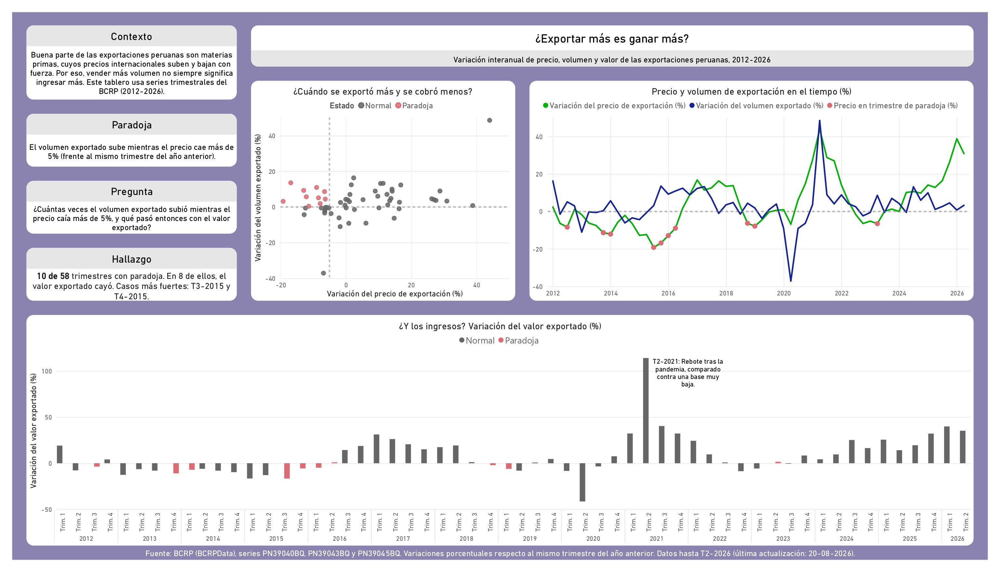

# ETL BCRP: ¿Exportar más es ganar más?

Pipeline de datos de punta a punta que consume la API del Banco Central de Reserva del Perú (BCRPData), la transforma y la carga en DuckDB, y la presenta en un dashboard de Power BI sobre las exportaciones peruanas.



## La pregunta

Buena parte de las exportaciones peruanas son materias primas, cuyos precios internacionales suben y bajan con fuerza. Por eso, vender más volumen no siempre significa ingresar más.

**¿Cuántas veces el volumen exportado subió mientras el precio caía más de 5%, y qué pasó entonces con el valor exportado?**

Definición usada: se marca un trimestre como **paradoja** cuando el volumen exportado sube y el precio de exportación cae más de 5%, ambos frente al mismo trimestre del año anterior.

## Hallazgos

- En **10 de 58 trimestres** (T1-2012 a T2-2026) hubo paradoja.
- En **8 de esos 10**, el valor exportado cayó.
- Los casos más fuertes fueron **T3-2015** (volumen +3.1%, precio -19.2%) y **T4-2015** (volumen +13.5%, precio -16.9%).
- T2-2021 (valor +114%) es un rebote tras la pandemia, calculado contra una base muy baja.

## Arquitectura

```
API BCRPData  →  Airflow (Extract → Transform → Load)  →  DuckDB  →  Power BI
```

| Capa | Herramienta | Qué hace |
|---|---|---|
| Orquestación | Apache Airflow 3.3 (Docker Compose) | Ejecuta el DAG `etl_bcrp` con programación mensual (`@monthly`) |
| Extracción | Python + `requests` | Una petición por serie a la API del BCRP |
| Transformación | Python | Convierte periodos como "T3.15" en fechas (2015-07-01) y alinea las series por fecha |
| Almacenamiento | DuckDB | Tabla `comercio_exterior`, con `fecha` como clave primaria |
| Visualización | Power BI + ODBC de DuckDB | Dashboard con la historia de la paradoja |

## Series utilizadas

Series trimestrales de BCRPData (grupo *Balanza comercial, variación porcentual*), cobertura T1-2012 a T2-2026, última actualización 20-08-2026.

| Código | Serie | Columna en DuckDB |
|---|---|---|
| PN39040BQ | Índice de Precios de X | `precio_x_var` |
| PN39042BQ | Términos de Intercambio | `terminos_intercambio_var` |
| PN39043BQ | Índice de Volumen de X | `volumen_x_var` |
| PN39045BQ | Índice de Valor de X | `valor_x_var` |

Las variaciones son porcentuales respecto al mismo trimestre del año anterior.

## Estructura del repositorio

```
etl-bcrp-airflow/
├── dags/etl_bcrp.py         # DAG: extraer → transformar → cargar
├── docs/                    # Capturas del dashboard
├── dashboard-bcrp.pbix      # Dashboard de Power BI
├── docker-compose.yaml      # Airflow con requests y duckdb instalados
├── config/ plugins/ data/   # Carpetas que monta Airflow (el .duckdb no se versiona)
└── .gitignore
```

## Cómo ejecutarlo

Requisitos: Docker Desktop (en Windows, con WSL2).

1. Clona el repositorio y crea un archivo `.env` con `AIRFLOW_UID=50000`.
2. Levanta Airflow:
   ```
   docker compose up -d
   ```
3. Abre `http://localhost:8080` (usuario `airflow`, contraseña `airflow`, valores por defecto del compose).
4. Activa y ejecuta el DAG `etl_bcrp`.
5. El resultado queda en `data/bcrp.duckdb`, tabla `comercio_exterior`.
6. Para detener todo: `docker compose down`.

> DuckDB admite un solo proceso de escritura. Cierra DBeaver o Power BI antes de ejecutar el DAG.

## Lecciones aprendidas

- **El orden de respuesta de la API no es el orden de la petición.** El BCRP devuelve las series ordenadas por código, no como se pidieron en la URL. Se resolvió con una petición por serie y un diccionario con nombres de columna.
- **Validar el mapeo de columnas antes de escribir.** Al cambiar una URL, una tabla anterior (`remesas`) se sobrescribió con datos de precios.
- **Cargas idempotentes.** `INSERT OR REPLACE` sobre una clave primaria de tipo fecha permite volver a ejecutar el DAG sin duplicar filas.
- **DuckDB admite un solo escritor.** Hay que desconectar las herramientas externas antes de cada ejecución.
- **Sumar tasas de variación no tiene sentido.** En Power BI las columnas `_var` se agregan con Promedio, no con Suma.
- **YAML y comillas.** Dentro de `${VARIABLE:-valor}` las comillas pasan a ser literales y rompían la instalación de paquetes con pip.
- **Verificar la fuente.** Que las series fueran interanuales se confirmó en la ficha de BCRPData, y los datos lo respaldan: la caída de T2-2020 no se compensa con un rebote en T3-2020.

## Fuente

Banco Central de Reserva del Perú, [BCRPData](https://estadisticas.bcrp.gob.pe/estadisticas/series/trimestrales/balanza-comercial). Datos hasta T2-2026.

## Autor

Christian Andre Rodriguez Angeles · Analista de datos · GitHub: [AndreRHz](https://github.com/AndreRHz)